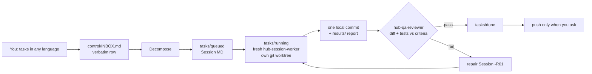

# Claude Hub — multi-agent task orchestration for Claude Code

> An open-source Claude Code multi-agent orchestration hub: a file-based task queue where autonomous AI agents (Claude by Anthropic) work in isolated git worktrees, with automated LLM code review and QA — a developer-tools workflow-automation kit and prompt-engineering playbook for any AI coding assistant.

**Dictate ten tasks at once; get ten verified, locally committed fixes.** Claude Hub is a drop-in folder that turns Claude Code (or Claude Desktop → Code) into an orchestrator: every request is logged, split into Sessions, run by a fresh worker agent, checked by an independent QA agent, and repaired automatically.

No server, no dependencies beyond Git (and optionally Python 3.8+). Works with any stack and any number of repositories, on Windows, macOS and Linux. Russian guide: [README.ru.md](README.ru.md).

## Why

Long single chats with an AI coding agent drift: context fills up, requests get lost, "done" means "I think it works". Claude Hub keeps the main session as a pure orchestrator and moves all state into plain Markdown files, so every task gets a clean context, a written acceptance bar and a second pair of eyes.

## How it works



- **INBOX** — every problem is recorded the moment it is heard; a row closes only as `done` (QA-verified) or `cancelled` by you.
- **Sessions** (`tasks/<state>/W###-S###-*.md`) — one problem each, with scope, acceptance criteria and guardrails ([template](orchestration/02_SESSION_TASK_TEMPLATE.md)).
- **Workers** run in fresh contexts, in parallel through `worktrees/` when they touch different code.
- **QA gate** — an independent reviewer checks each criterion against the real diff and tests; failures spawn repair Sessions automatically.
- **Safety hooks** (`.claude/hooks/`) block force-push, history rewrites, author spoofing, writes outside allowed roots, and warn before the context window overflows. `python tools/guard_test.py` runs 217 guard cases.
- **Memory** lives in files: `project/` (profile, invariants, conventions, your standing rules, learnings) and `control/` (goals, decisions, next-session prompt).

Full procedures: [`CLAUDE.md`](CLAUDE.md) and [`orchestration/`](orchestration/).

## Quick start

1. Clone or unzip **outside** any other repo (parent `CLAUDE.md` files would mix in): `git clone <this repo> ~/ClaudeHub`
2. Put Markdown notes about your product into `context/` (architecture, rules, how to test) — optional, can be later.
3. Open the folder in Claude Code (`cd ~/ClaudeHub && claude`) or Claude Desktop → Code → Local. Use the strongest model and **Auto** permission mode; trust the folder so hooks load.
4. Say "hi" (or a task). The hub asks once for your repositories:
   ```
   api — /home/me/shop-api — backend
   web — /home/me/shop-web — frontend
   ```
5. When setup finishes, open a **new session** and write "continue". Then just dictate work.

## Using it well

- **Batch requests.** "Three things: 1) … 2) … 3) …" becomes three isolated Sessions.
- **Say rules once.** "From now on, always write a test before the fix" goes to `project/OVERRIDES.md` and applies to every future Session.
- **Ask `status`** for done / running / queued / waiting-on-you.
- **Feed context, not chat.** Update files in `context/` and say "refresh context" instead of re-explaining.
- **Start new sessions freely.** When context grows, the hub prints a ready handoff prompt; paste it or say "continue". Nothing is lost.
- **Pushing is yours.** Commits stay local until you explicitly ask to push; never forced.
- **Upgrade safely.** Replace the engine (`CLAUDE.md`, `.claude/`, `orchestration/`, `tools/`, `README*`), keep the state (`project/`, `control/`, `tasks/`, `results/`, `context/`, `archive/`).

See [`examples/`](examples/) for sample messages and Session files.

## FAQ

**Does it need an API key or server?** No. It is just files that Claude Code reads.
**Which language?** Any; the hub replies in the language set at setup.
**Without Python?** Works, but without safety hooks and `tools/hub.py` status/ids.
**1M-context model?** Say so; the hub raises its budget thresholds.

## Contributing

Issues and PRs welcome — see [CONTRIBUTING.md](CONTRIBUTING.md). License: [MIT](LICENSE).

<sub>Keywords: Claude Code orchestrator, AI coding agents, multi-agent workflow, autonomous agents, task queue, git worktree, QA review agent, prompt engineering, LLM developer tools.</sub>
