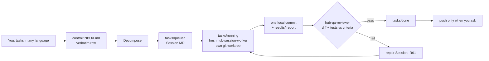

# Claude Hub — autonomous multi-agent orchestration for Claude Code

**Dictate ten tasks at once; get ten verified, locally committed changes.** Claude Hub is a drop-in folder that turns Claude Code into an orchestrator: each request becomes a Session run by a fresh worker agent, checked by an independent QA agent and repaired automatically. When the context fills up, the hub hands off to a new session by itself.

**For:** developers who use Claude Code on real repositories and want many tasks done in parallel without babysitting long chats.

**Key features**
- **Autonomous session handoff** — near the context limit the hub saves its state, starts a new background session and stops the old one.
- **Parallel sessions in git worktrees** — workers run in isolated worktrees, one local commit each.
- **Independent QA + auto-repair** — a reviewer checks the real diff and tests against acceptance criteria; failures spawn repair Sessions.
- **Safety hooks** — block force-push, history rewrites, author spoofing and writes outside allowed folders.
- **File-based memory** — goals, rules, decisions and handoffs live in plain Markdown.
- **No server** — only Git (Python 3.8+ recommended for hooks). Any stack, Windows/macOS/Linux.

Russian guide: [README.ru.md](README.ru.md).

## Why

Long single chats with an AI coding agent drift: context fills up, requests get lost, "done" means "I think it works". Claude Hub keeps the main session as a pure orchestrator and moves all state into plain Markdown files, so every task gets a clean context, a written acceptance bar and a second pair of eyes.

## How it works



- **INBOX** — every problem is recorded the moment it is heard; a row closes only as `done` (QA-verified) or `cancelled` by you.
- **Sessions** (`tasks/<state>/W###-S###-*.md`) — one problem each, with scope, acceptance criteria and guardrails ([template](orchestration/02_SESSION_TASK_TEMPLATE.md)).
- **Workers** run in fresh contexts, in parallel through `worktrees/` when they touch different code.
- **QA gate** — an independent reviewer checks each criterion against the real diff and tests; failures spawn repair Sessions automatically.
- **Safety hooks** (`.claude/hooks/`) block force-push, history rewrites, author spoofing, writes outside allowed roots, and warn before the context window overflows. `python tools/guard_test.py` runs 217 guard cases.
- **Memory** lives in files: `project/` (profile, invariants, conventions, your standing rules, learnings) and `control/` (goals, decisions, next-session prompt).

Full procedures: [`CLAUDE.md`](CLAUDE.md) and [`orchestration/`](orchestration/).

## Example

A `todo-app` repo is registered. You type: *"Three things: add dark mode, fix the login bug where a wrong password still redirects, write tests for the task list."*

1. The hub logs all three verbatim in `control/INBOX.md` and creates `W001-S001-dark-mode`, `W001-S002-login-redirect`, `W001-S003-tasklist-tests` in `tasks/queued/`, each with acceptance criteria.
2. Three fresh workers start in parallel, each in its own worktree under `worktrees/`; each makes one local commit and writes a report in `results/`.
3. QA passes S001 and S003 but fails S002: the redirect is fixed, yet no test covers the wrong-password case. The hub spawns `W001-S002-R01`, a worker adds the test, QA passes it.
4. `status` shows 3/3 done, all committed locally. Nothing is pushed until you say so.
5. Later the context nears its limit: the hub writes `control/NEXT-SESSION-PROMPT.md`, starts a new background session that picks up the queue, and the old one stops. You keep dictating.

## Quick start

1. Clone or unzip **outside** any other repo (parent `CLAUDE.md` files would mix in): `git clone <this repo> ~/ClaudeHub`
2. Put Markdown notes about your product into `context/` (architecture, rules, how to test) — optional, can be later.
3. Open the folder in Claude Code (`cd ~/ClaudeHub && claude`) or Claude Desktop → Code → Local. Use the strongest model and **Auto** permission mode; trust the folder so hooks load.
4. Say "hi" (or a task). The hub asks once for your repositories:
   ```
   api — /home/me/shop-api — backend
   web — /home/me/shop-web — frontend
   ```
5. When setup finishes, open a **new session** and write "continue". Then just dictate work.


## Autonomous session handoff

Long orchestrator sessions get expensive and eventually compact. The hub hands itself off instead:

1. `context_budget.py` (UserPromptSubmit) warns, then asks for the `hub-handoff` skill at the handoff threshold.
2. Past the stop threshold, `session_relay.py` (Stop hook) checks that `control/NEXT-SESSION-PROMPT.md` was
   refreshed; if not, it sends the session back once to write it.
3. With a fresh handoff, or right before an auto-compaction (PreCompact, matcher `auto`), it writes
   `control/handoff/RELAY-<stamp>.md`, starts `claude --bg --name hub-relay-<stamp> "<continue prompt>"` in the
   hub and returns `continue: false` so the old session stops (compaction is blocked).
4. `control/locks/RELAY.lock` (atomic, stale after 30 min) plus a per-session marker guarantee one relay per
   session and no double runners. Subagents and manual `/compact` are never relayed.

List or open the new session with `claude agents` / `claude attach <id>`. Configure in `control/hub-config.json`:
`"relay": {"enabled": true, "command": ["claude", "--bg"], "extra_args": [], "stale_minutes": 30, "fresh_minutes": 20}`.
Dry run: `HUB_RELAY_DRY_RUN=1`. Tests: `python3 .claude/hooks/session_relay.py --selftest`.
Limits: a background session cannot answer permission prompts, so `ask` rules (e.g. `git push`) still wait for
you; the old window stays open but idle.

## Using it well

- **Batch requests.** "Three things: 1) … 2) … 3) …" becomes three isolated Sessions.
- **Say rules once.** "From now on, always write a test before the fix" goes to `project/OVERRIDES.md` and applies to every future Session.
- **Ask `status`** for done / running / queued / waiting-on-you.
- **Feed context, not chat.** Update files in `context/` and say "refresh context" instead of re-explaining.
- **Start new sessions freely.** When context grows, the hub writes a handoff and, with the relay hook on, starts the next session itself. Nothing is lost.
- **Pushing is yours.** Commits stay local until you explicitly ask to push; never forced.
- **Upgrade safely.** Replace the engine (`CLAUDE.md`, `.claude/`, `orchestration/`, `tools/`, `README*`), keep the state (`project/`, `control/`, `tasks/`, `results/`, `context/`, `archive/`).

See [`examples/`](examples/) for sample messages and Session files.

## FAQ

**Does it need an API key or server?** No. It is just files that Claude Code reads.
**Which language?** Any; the hub replies in the language set at setup.
**Without Python?** Works, but without safety hooks and `tools/hub.py` status/ids.
**1M-context model?** Say so; the hub raises its budget thresholds.

## Contributing

Issues and PRs welcome — see [CONTRIBUTING.md](CONTRIBUTING.md). License: [MIT](LICENSE).

<sub>Keywords: Claude Code orchestrator, AI coding agents, multi-agent workflow, autonomous agents, task queue, git worktree, QA review agent, prompt engineering, LLM developer tools.</sub>
